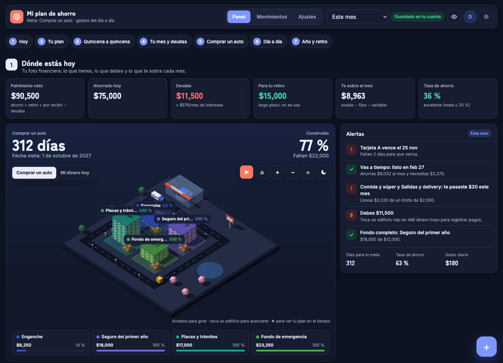
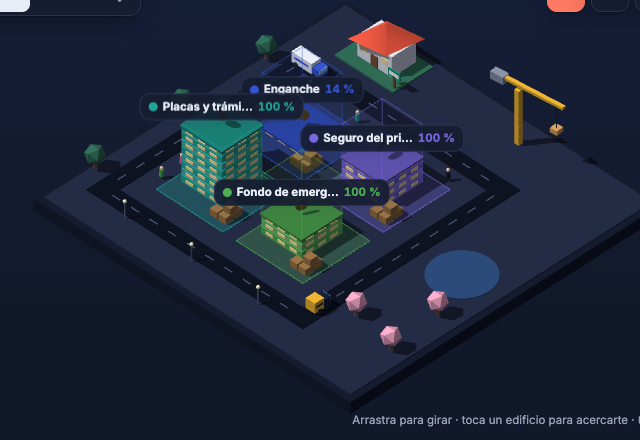
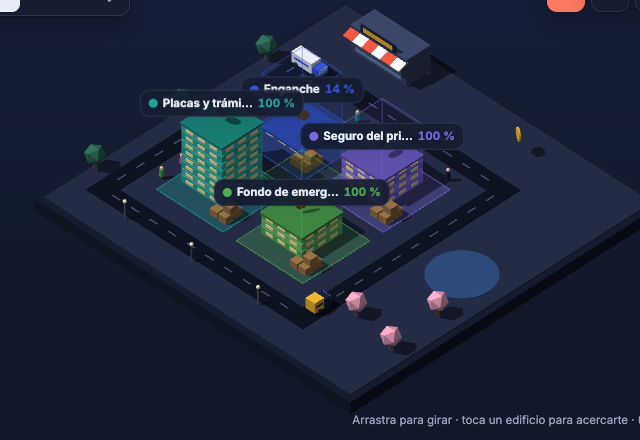
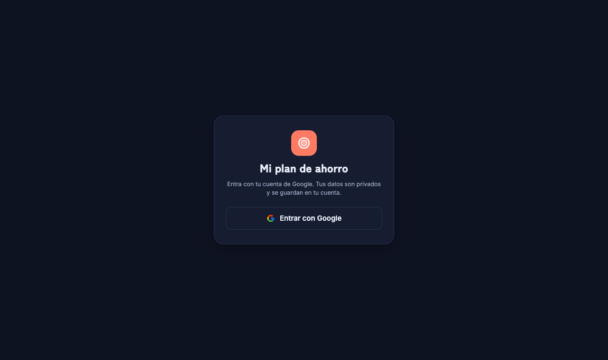

# Mi plan de ahorro

Panel personal para ahorrar hacia una meta grande (un auto, un enganche, un viaje, lo que sea) sin perder de vista los gastos del día a día.

Es una sola página HTML. Entras con tu cuenta de Google y tus datos se guardan en Firebase (Firestore). Cada persona solo puede ver y editar lo suyo.



> Las capturas usan datos inventados.

## Qué hace

- **Fondos de tu meta.** Divides la meta en partes, por ejemplo enganche, seguro, trámites y emergencia. Cada fondo es un edificio de una maqueta 3D isométrica que se va construyendo conforme ahorras.
- **La maqueta cambia según tu meta.** Si ahorras para un auto, aparece una agencia con un auto girando en la vitrina. Una casa trae una obra con grúa; un viaje, un aeropuerto con un avión que despega; los estudios, una escuela con reloj y bandera; un negocio, un local con toldo. Cualquier otra meta muestra un banco con una alcancía. Se detecta por el nombre de tu meta o lo eliges en Ajustes.
- **Dónde estás hoy.** Patrimonio neto, ahorro, deudas, retiro, cuánto te sobra al mes y tu tasa de ahorro.
- **Alertas.** Fechas límite de tus tarjetas, si vas a tiempo para tu fecha meta, categorías que pasaron su límite y fondos completos.
- **Plan en 4 pasos.** Colchón de emergencia, liquidar deudas, pagos comprometidos y meta, cada paso con su avance.
- **Quincena a quincena.** Proyección de cada pago hasta tu fecha límite, con controles para simular cuánto gastas y qué gastos fijos dejas de pagar.
- **Tarjetas y deudas.** Saldo, tasa anual, día de corte, mejor día para comprar y fecha límite de pago, con calendario.
- **Gastos fijos, pagos próximos, dinero por recibir y límites del mes** por categoría.
- **Retiro e inversiones** a largo plazo, en pesos o en UDIs.
- **Consejos con tus números**, por ejemplo "págate primero", qué hacer con el aguinaldo o cuánto ganas si recortas un gasto.
- **Movimientos.** Registro rápido de gastos, ahorros, pagos de deuda e ingresos. Tiene atajos para tus gastos fijos, filtros y opciones para editar y borrar.
- **Otra moneda.** Muestra tus montos también en otra moneda con el tipo de cambio que tú pongas.
- **Privacidad.** Botón para ocultar montos y bloqueo opcional con PIN.
- **Respaldo.** Descarga e importa tus datos en JSON.
- Tema claro y oscuro, funciona en el celular y sin conexión (se sincroniza al volver).

### Escenarios de la maqueta

| Auto | Casa | Viaje |
|---|---|---|
|  |  |  |
| **Estudios** | **Negocio** | **Otra meta** |
|  |  |  |

### Más pantallas

| Movimientos | Ajustes |
|---|---|
|  |  |

<p align="center"></p>

## Cómo está hecho

- `public/index.html`: toda la app (HTML, CSS y JavaScript sin framework). Las gráficas son SVG hechas a mano y la maqueta usa [three.js](https://threejs.org/).
- Inicio de sesión con **Firebase Authentication** (Google).
- Datos en **Cloud Firestore**, en `data/users/{uid}/{documento}`. Hay un documento `config` con tu plan y un documento por movimiento.
- `firestore.rules`: solo el dueño de la cuenta puede leer y escribir sus documentos.
- Funciona en **Vercel** o en **Firebase Hosting**. No hay llaves en el código: en Vercel, `scripts/build-config.mjs` crea `public/firebase-config.js` con variables de entorno; en Firebase Hosting la configuración se carga sola desde `/__/firebase/init.js`.

## Publicar tu propia copia

Necesitas Node.js y una cuenta de Google.

1. Clona el repositorio:
   ```bash
   git clone https://github.com/Niicko12/plan-de-ahorro.git
   cd plan-de-ahorro
   ```
2. Inicia sesión en Firebase y crea un proyecto:
   ```bash
   npx firebase-tools login
   npx firebase-tools projects:create mi-ahorro-xxxx
   npx firebase-tools apps:create WEB "Mi plan de ahorro" --project mi-ahorro-xxxx
   ```
3. Copia `.firebaserc.example` a `.firebaserc` y pon el ID de tu proyecto.
4. En la [consola de Firebase](https://console.firebase.google.com/):
   - **Authentication → Método de inicio de sesión → Google → Habilitar.**
   - **Firestore Database → Crear base de datos** (edición Standard, modo de producción).
5. Publica las reglas y la página:
   ```bash
   npx firebase-tools deploy
   ```
   Al terminar te da una dirección como `https://mi-ahorro-xxxx.web.app`.

### En Vercel

1. Haz los pasos 1 a 4 de arriba y publica solo las reglas: `npx firebase-tools deploy --only firestore:rules`.
2. Saca la configuración de tu app web con `npx firebase-tools apps:sdkconfig WEB`.
3. Importa el repositorio en Vercel y agrega estas variables de entorno:
   `FIREBASE_API_KEY`, `FIREBASE_AUTH_DOMAIN`, `FIREBASE_PROJECT_ID`, `FIREBASE_APP_ID` y `FIREBASE_MESSAGING_SENDER_ID`.
4. En Firebase, **Authentication → Configuración → Dominios autorizados**, agrega tu dominio de Vercel (por ejemplo `tu-app.vercel.app`).

Para probarla en tu computadora usa `npx firebase-tools serve`. Abrir el archivo directamente no funciona, porque la configuración de Firebase solo existe en el servidor.

## Licencia

MIT. Ver [LICENSE](LICENSE).

Los cálculos son orientativos y no sustituyen a un asesor financiero.
